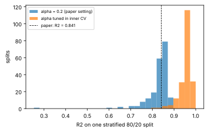
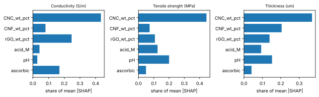

# Data-Driven Materials Optimization

Regression, feature-selection stability and SHAP attribution on **60 measured
CNC/CNF/rGO nanocomposite films**, evaluated with nested cross-validation.
The data are Tables 2 and 3 of Ramezani et al., *Micromachines* 16(4), 393
(2025), [doi:10.3390/mi16040393](https://doi.org/10.3390/mi16040393): 30 films
reduced with citric acid and 30 with L-ascorbic acid, each with measured
electrical conductivity, tensile strength and thickness.

## Results

Every number below is regenerated by `python scripts/run_all.py` and stored in
[`results/summary.json`](results/summary.json).

### Out-of-sample R², nested cross-validation

Outer loop: 5-fold stratified by reducing agent, repeated 5 times (25 folds).
Inner loop: 5-fold grid search on each outer training fold. Scaling is fitted
inside each training fold. The last column holds out every film of a
(CNC, CNF, rGO) composition together, so it tests compositions never seen in
training.

| Model | R², all targets (mean ± s.d. over folds) | Conductivity | Tensile strength | Thickness | Composition-grouped R² |
|---|---|---|---|---|---|
| Mean predictor | −0.082 ± 0.080 | −0.099 | −0.084 | −0.064 | −0.053 |
| Linear regression | 0.958 ± 0.022 | 0.996 | 0.989 | 0.888 | 0.965 |
| LASSO, alpha = 0.2 (paper setting) | 0.841 ± 0.028 | 0.648 | 0.980 | 0.893 | 0.853 |
| LASSO, alpha tuned in inner CV | 0.957 ± 0.022 | 0.996 | 0.987 | 0.889 | 0.965 |
| Multi-output neural network | 0.988 ± 0.014 | 0.998 | 0.995 | 0.971 | 0.992 |

### Reproducing the published LASSO result

The paper reports overall R² = 0.841 for LASSO with α = 0.2 on an 80/20 split.
The same setting gives a median R² of **0.843**
over 200 stratified 80/20 splits (5th–95th percentile
0.75–0.87), so the
published figure reproduces. With raw targets, one shared α shrinks the
small-scale target hardest: conductivity (0.28–1.72 S/m) reaches
R² ≈ 0.65 while
tensile strength reaches 0.98.
Standardizing the targets and choosing α in the inner loop raises the median
single-split R² to 0.961 and nested-CV R² to
0.957.

### Collinearity and selection stability

Composition, acid concentration, pH and the reducing agent are strongly
coupled in this campaign (variance inflation factors: pH 50, agent
41, CNC 25, acid 19). Bootstrap
selection frequency of each input at α = 0.2 on standardized data, 200
resamples:

| Target | CNC | CNF | rGO | Acid | pH | Agent |
|---|---|---|---|---|---|---|
| Conductivity | 1.00 | 0.00 | 1.00 | 0.00 | 0.00 | 0.00 |
| Tensile | 1.00 | 0.00 | 1.00 | 0.00 | 0.00 | 0.30 |
| Thickness | 0.04 | 0.14 | 1.00 | 0.37 | 0.04 | 0.00 |

rGO is selected in every resample for every target, and CNC for conductivity
and tensile strength. Acid concentration, pH and the agent indicator carry
overlapping information and LASSO keeps whichever one fits a given resample;
the stable conclusion concerns the group. The full regularization path is in
[`results/lasso_selection_frequency.csv`](results/lasso_selection_frequency.csv).

### SHAP attribution

Kernel SHAP on the final multi-output network and LASSO (exact enumeration of
all coalitions of the six inputs). Per input, the network gives CNC more
credit and LASSO gives rGO more, because the two are correlated at 0.92 and
their split is not identifiable from these data. SHAP values are additive, so
summing within groups gives an identifiable quantity, and there the models
agree. Share of attribution carried by composition (CNC, CNF, rGO), the rest
being reduction chemistry (acid, pH, agent):

| Target | Multi-output network | LASSO |
|---|---|---|
| Conductivity | 0.85 | 0.88 |
| Tensile | 0.83 | 0.83 |
| Thickness | 0.85 | 0.91 |

### Screening inside the measured region

`ddmo/optimize.py` scores 20,000 candidates built as convex combinations of
measured films with the same reducing agent, which keeps the coupled pH and
acid concentration realistic, under the paper's objective
F = 0.7σ + 0.3Ts. The best measured film (L-ascorbic acid #28, F = 15.00)
is not beaten by any candidate under both models: it sits on the edge of the
measured design, so further gains require experiments beyond it. That is the
setting for sequential design with calibrated uncertainty, developed in
[materials-mobo](https://github.com/Ghazaleh-Ramezani/materials-mobo).

## Notebooks

Executed notebooks with outputs, built by `python scripts/build_notebooks.py`:

1. [`01_eda_and_linear_regression.ipynb`](notebooks/01_eda_and_linear_regression.ipynb): distributions, correlations, VIF, linear baselines
2. [`02_feature_selection_lasso.ipynb`](notebooks/02_feature_selection_lasso.ipynb): paper setting vs tuned α, split-to-split spread, selection stability
3. [`03_nonlinear_models_and_optimization.ipynb`](notebooks/03_nonlinear_models_and_optimization.ipynb): multi-output network, grouped SHAP, in-range screening

## Reproduce

    pip install -r requirements.txt
    python -m pytest -q                  # 20 tests, a few seconds
    python scripts/run_all.py            # about 5 minutes on 2 CPU cores
    python scripts/build_notebooks.py    # executes the notebooks

`ddmo.data.load_films` checks the dataset against its recorded SHA-256.

## Structure

    data/cnc_cnf_rgo_films.csv     60 films, Tables 2 and 3 of the paper (see data/README.md)
    ddmo/data.py                   loading, encoding, composition groups, VIF
    ddmo/models.py                 pipelines and inner-loop grids
    ddmo/evaluation.py             nested CV, composition-grouped CV, split spread
    ddmo/interpret.py              bootstrap selection frequency, Kernel SHAP, grouped SHAP
    ddmo/optimize.py               convex-hull candidate screening
    scripts/run_all.py             regenerates results/
    scripts/build_notebooks.py     writes and executes notebooks/
    results/                       summary.json, per-fold scores, stability, SHAP, figures
    tests/                         data integrity, leakage, protocol and reproduction tests

## Tested with

Python 3.13.16, NumPy 2.5.3, pandas 3.0.5,
scikit-learn 1.9.1, SHAP 0.54.1, matplotlib 3.11.2; CPU only.

## Citation

    G. Ramezani, I. Ocampo Silva, I. Stiharu, T. G. M. van de Ven, V. Nerguizian,
    "Lasso Model-Based Optimization of CNC/CNF/rGO Nanocomposites,"
    Micromachines 16(4), 393 (2025). doi:10.3390/mi16040393

## Author

Ghazaleh Ramezani — Materials Science & Machine Learning, Concordia University
